<h1 align="center">
  
<br>

<br>AGV-Vote<br>
<em>"Site do grêmio estudantil"</em>
<br><br>


<a href="https://github.com/AntonAbbac/AGV-vote/blob/main/LICENSE">

</a>
</h1>

## ⚠️ CAUTION

> Este é um projeto completamente livre de quaisquer barreiras institucionais.

---

## Sobre

Site do Grêmio Estudantil do Colégio Estadual Alberto Gomes Veiga (Paranaguá, PR): apresentação do
Grêmio, chapas com propostas e integrantes, votação com conta institucional, notícias e suporte.
HTML, CSS e JavaScript puros, com [PocketBase](https://pocketbase.io) como servidor.


## Páginas

| Página | O que faz | Acesso |
|---|---|---|
| `pages/home.html` | Apresentação e explicação do Grêmio | público |
| `pages/chapas.html` | Abas com sobre, propostas e integrantes de cada chapa | público |
| `pages/votacao.html` | Votar em uma chapa ou em branco | exige login |
| `pages/login.html` | Entrar, primeiro acesso e recuperar senha | público |
| `pages/noticias.html` | Notícias com busca e cartão do Instagram | público |
| `pages/suporte.html` | Formulário de dúvidas e sugestões | público |
| `pages/form.html` | Cadastro de chapa | líderes e administradores |

Para exigir login em outra página, coloque `data-auth="required"` na tag `<body>` dela.

## Estrutura

```
index.html                 redireciona para pages/home.html
pages/                     as páginas
pocketbase/root.js         endereço do servidor e opções do site
pocketbase/api.js          todas as chamadas ao PocketBase (coleções e campos ficam só aqui)
pocketbase/*.js            lógica de cada página (login, chapas, votacao, form, noticias, suporte)
scripts/app.js, layout.js  utilitários, cabeçalho e rodapé
styles/style.css           estilos
assets/                    logo, fundo, ícones e emblemas das chapas (assets/chapas/)
documentation/             guia do PocketBase e dados de exemplo
tests/                     teste automatizado (python3 tests/e2e.py)
```

---

## 👥 Credits

Projeto criado por alunos para alunos.

---

## 📃 License

This project is licensed under the MIT License.
See the LICENSE file for details.

---
